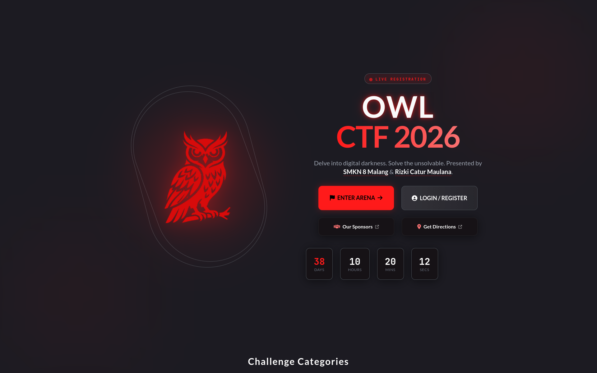
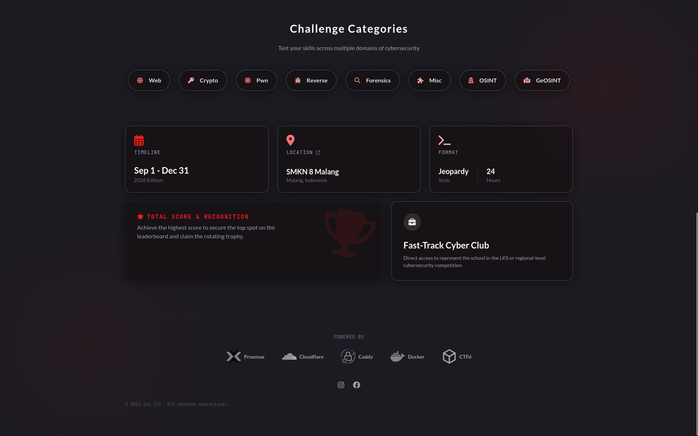
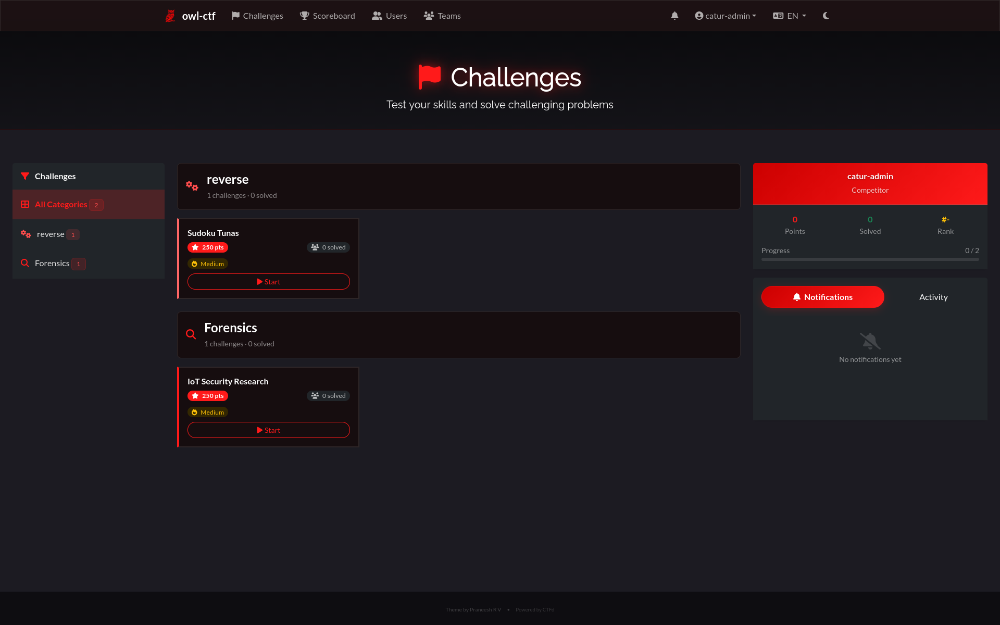
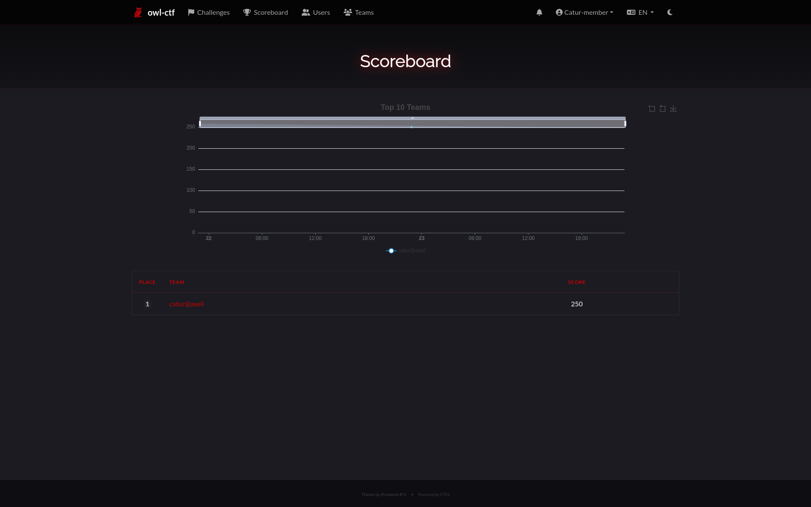
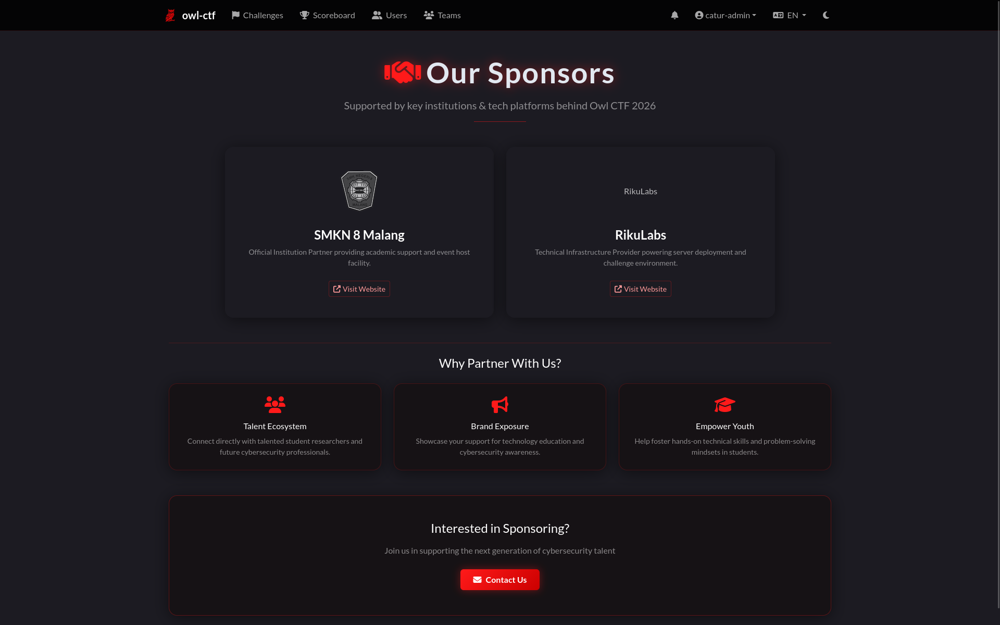
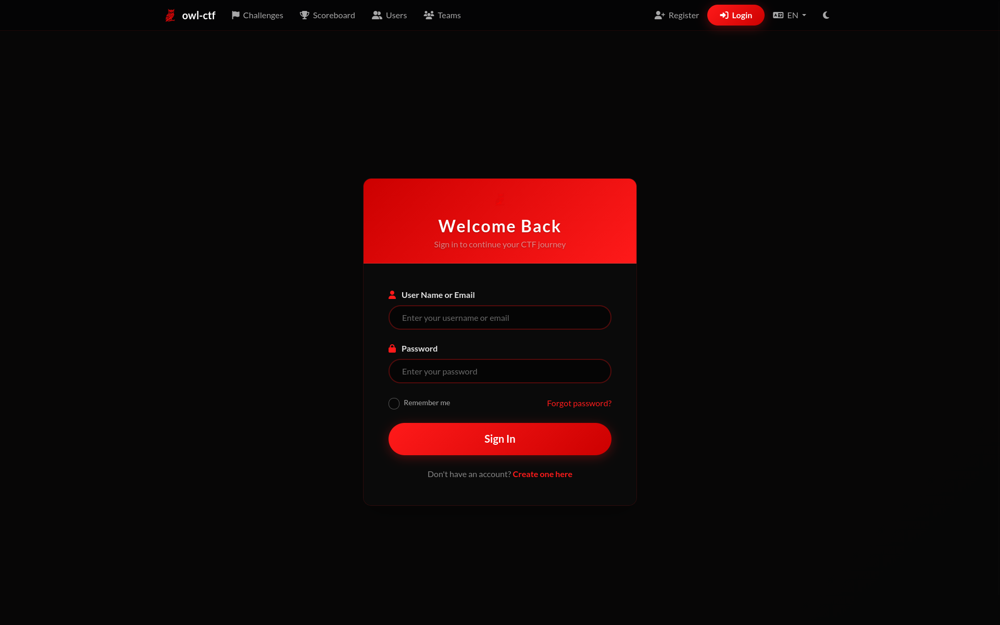
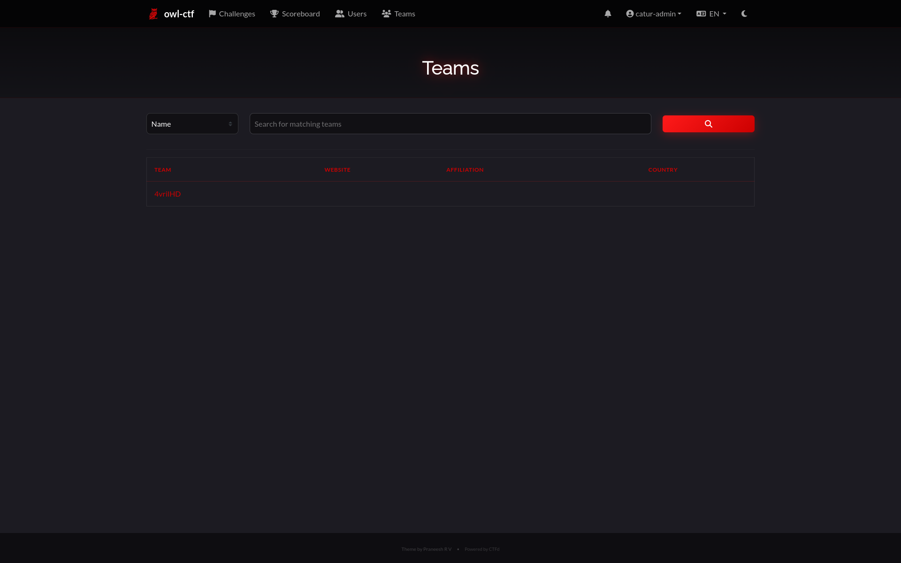
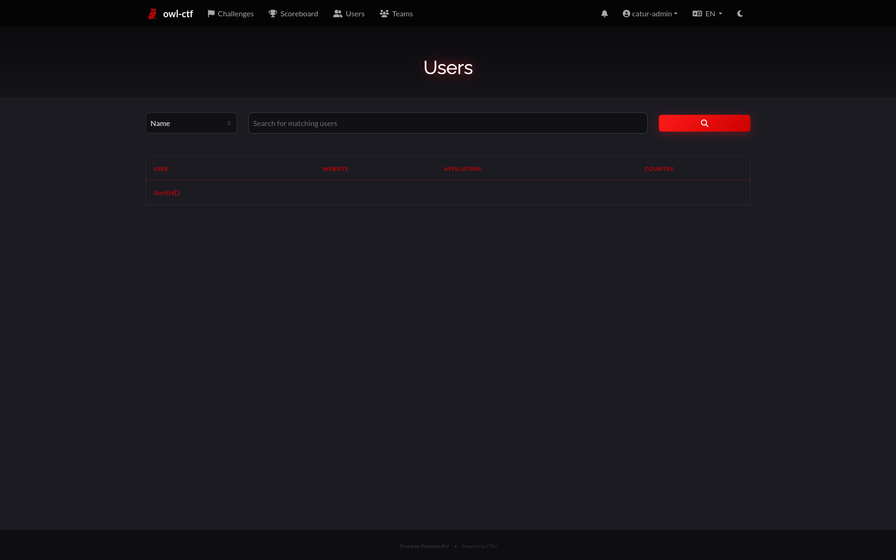

<p align="center">
  
</p>

<h1 align="center">Owl CTF Theme 🦉</h1>

<p align="center">
  <b><i>Enter the Abyss</i></b> — A premium Dark Obsidian & Crimson Glassmorphism theme for <a href="https://ctfd.io/">CTFd</a>.
</p>

<p align="center">
  
  
  
  
  
  
</p>

---

## 📖 Tentang Owl CTF Theme

**Owl CTF Theme** adalah tema kustom CTFd berdesain modern bertema *cyber-abyss*, menggabungkan palet warna **Dark Obsidian** (`#0a0a0a`), aksen **Crimson Glow** (`#ff1a1a`), dan efek **Glass-morphism** (frosted glass blur). Tema ini dirancang khusus untuk event **Owl CTF 2026** yang diselenggarakan oleh **SMKN 8 Malang** bersama **Rizki Catur Maulana** ([@Rizzkiy](https://github.com/Rizzkiy)).

Tema ini menghadirkan pengalaman visual arena kompetisi hacking yang imersif, lengkap dengan landing page Tailwind CSS mandiri, efek teks glitch interaktif, live countdown timer, halaman sponsor terdedikasi, serta dashboard tantangan (challenges) yang telah diperbarui dengan pelacak progres peserta.

---

## 📸 Showcase & Tampilan Antarmuka

Berikut adalah tampilan visual dari berbagai halaman di dalam tema Owl CTF:

### 🏠 Landing Page & Hero Section
| **Homepage Hero & Countdown** | **Event Details & Categories** |
| :---: | :---: |
|  |  |
| *Hero section dengan logo Owl bercahaya, glitch typography, tombol navigasi arena, dan live countdown timer.* | *Daftar kategori tantangan (Web, Crypto, Pwn, Reverse, Forensics, Misc, OSINT, GeOSINT), info venue SMKN 8 Malang, format acara, serta partner.* |

---

### 🚩 Challenges & Scoreboard
| **Challenges Arena** | **Scoreboard** |
| :---: | :---: |
|  |  |
| *Arena tantangan dengan sidebar filter kategori, kartu tantangan beraksen merah, dan kartu status progres kompetitor.* | *Papan skor real-time dengan grafik visualisasi pergerakan poin tim (ECharts) dan tabel peringkat.* |

---

### 🤝 Sponsors & Autentikasi
| **Our Sponsors** | **Login & Autentikasi** |
| :---: | :---: |
|  |  |
| *Halaman khusus partner & sponsor (SMKN 8 Malang & RikuLabs) lengkap dengan pilar kerjasama dan tombol kontak.* | *Tampilan form login dan registrasi bergaya obsidian card dengan aksen merah menyala.* |

---

### 👥 Direktori Tim & Pengguna
| **Daftar Tim (Teams)** | **Daftar Pengguna (Users)** |
| :---: | :---: |
|  |  |
| *Direktori tim peserta dengan kolom pencarian dan tabel transparan bergaris merah.* | *Daftar seluruh peserta kompetisi dengan status afiliasi dan negara.* |

---

## ✨ Fitur Utama

- 🔴 **Dark Obsidian & Crimson Glassmorphism**: Tampilan gelap berkelas dengan panel kaca transparan (`backdrop-filter: blur(12px)`), batas tepi glow neon merah, dan palet warna obsidian.
- ⚡ **Tailwind CSS Landing Page (`templates/index.html`)**: Halaman beranda kustom beranimasi glitch, efek scanline retro-cyber, dan penghitung mundur (countdown) menuju kick-off event.
- 🎯 **8 Kategori Tantangan Siap Pakai**: Mendukung kategori Web, Crypto, Pwn, Reverse Engineering, Digital Forensics, Miscellaneous, OSINT, dan GeOSINT.
- 📊 **Enhanced Challenges View**: Tata letak kartu soal dilengkapi indikator difficulty, jumlah solved, serta kartu profil samping untuk melihat poin, peringkat, dan notifikasi terkini.
- 🤝 **Halaman Sponsor Khusus (`templates/sponsors.html`)**: Template siap pakai untuk menampilkan profil partner institusi dan sponsor infrastruktur.
- 📱 **Fully Responsive Layout**: Desain adaptif yang optimal diakses melalui layar desktop, tablet, maupun smartphone.
- 🚀 **Performa Cepat**: Dibangun dengan Vite, SCSS modular, Alpine.js, dan Bootstrap 5 yang terintegrasi rapi dengan backend CTFd.

---

## 📦 Panduan Instalasi

### 1. Salin Tema ke Direktori CTFd

Pastikan direktori tema ini berada di dalam folder `themes/` pada instalasi CTFd Anda:

```bash
# Clone repository
git clone https://github.com/Rizzkiy/owl-ctf.git

# Pindahkan / salin ke folder themes CTFd
cp -r owl-ctf /path/to/CTFd/CTFd/themes/
```

Jika Anda menggunakan Docker Compose:

```yaml
# docker-compose.yml
services:
  ctfd:
    ...
    volumes:
      - ./owl-ctf:/opt/CTFd/CTFd/themes/owl-ctf
```

### 2. Aktifkan Tema di Admin Panel

1. Masuk ke halaman **Admin Panel** CTFd Anda (`http://your-ctfd-url/admin`).
2. Masuk ke menu **Config** > **Themes**.
3. Pilih tema **Owl CTF** (atau `owl-ctf`).
4. Klik tombol **Update** untuk menyimpan.
5. Kunjungi halaman utama CTFd Anda untuk melihat tema aktif.

---

## 🛠️ Kustomisasi Tema

### Mengubah Target Waktu Countdown
Buka file `templates/index.html` dan cari baris berikut di bagian bawah script:

```javascript
// Atur tanggal & jam target event Anda
const countDownDate = new Date("Dec 31, 2026 09:00:00").getTime();
```

### Mengubah Warna & Variabel Tema
Variabel warna utama didefinisikan pada `templates/base.html` dan konfigurasi Tailwind di `templates/index.html`:

```css
:root {
  --red: #ff1a1a;
  --red-light: #ff4d4d;
  --red-dim: #cc0000;
  --red-dark: #661111;
  --red-glow: rgba(255, 26, 26, 0.5);
}
```

### Build & Pengembangan Aset (Opsional)
Jika Anda ingin memodifikasi file JavaScript atau SCSS sumber:

```bash
# Instal dependensi
yarn install

# Jalankan server pengembangan Vite (watch mode)
yarn dev

# Compile aset untuk produksi
yarn build
```

---

## ⚙️ Ekosistem & Infrastruktur (Powered By)

Owl CTF didukung oleh ekosistem infrastruktur dan teknologi modern:

- **[CTFd](https://ctfd.io/)** — Platform kompetisi Capture The Flag.
- **[Proxmox VE](https://www.proxmox.com/)** — Virtualisasi hypervisor untuk sandbox & container challenge.
- **[Cloudflare](https://www.cloudflare.com/)** — Perlindungan DDoS, DNS, dan CDN caching.
- **[Caddy Server](https://caddyserver.com/)** — Reverse proxy dengan otomatisasi TLS/HTTPS.
- **[Docker](https://www.docker.com/)** — Orkestrasi kontainer layanan dan dependensi CTFd.

---

## 🙏 Kredit & Inspirasi

Proyek ini tidak akan terwujud tanpa karya luar biasa dari komunitas open source:

1. **[CTFd](https://ctfd.io/)** — Terima kasih yang sebesar-besarnya kepada tim pembuat **CTFd** ([GitHub Repository](https://github.com/CTFd/CTFd)) atas platform open-source CTF standar industri yang fleksibel dan luar biasa.
2. **Inspirasi & Tema Dasar — [Stargaze Theme](https://github.com/PraneeshRV/CTFd-stargaze-theme)**:
   - Tema ini terinspirasi dan dikembangkan berbasis struktur awal tema [**CTFd Stargaze Theme**](https://github.com/PraneeshRV/CTFd-stargaze-theme) oleh **[Praneesh R V](https://github.com/PraneeshRV)**.
   - Konsep tata letak glass-morphism awal diadaptasi dan dirombak ulang (redesigned) menjadi tema berkarakter dark cyberpunk bernuansa merah (*Owl Abyss Aesthetic*), dilengkapi landing page baru, halaman sponsor, serta integrasi visual Owl CTF.
3. **[SMKN 8 Malang](https://smkn8malang.sch.id/)** — Mitra institusi resmi dan penyedia fasilitas ajang kompetisi Owl CTF.
4. **RikuLabs** — Penyedia infrastruktur teknis dan server kompetisi.

---

## 👤 Pembuat & Pengembang

* **Rizki Catur Maulana** — *Lead Developer & Organizer*
  * GitHub: [@Rizzkiy](https://github.com/Rizzkiy)
  * Institusi: SMKN 8 Malang / RikuLabs

---

## 📄 Lisensi

Proyek ini dilisensikan di bawah lisensi [MIT License](LICENSE) — bebas digunakan dan dikembangkan untuk keperluan kompetisi CTF Anda dengan tetap mempertahankan atribusi kredit kepada pembuat tema dan CTFd.
